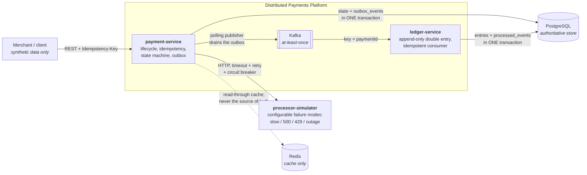
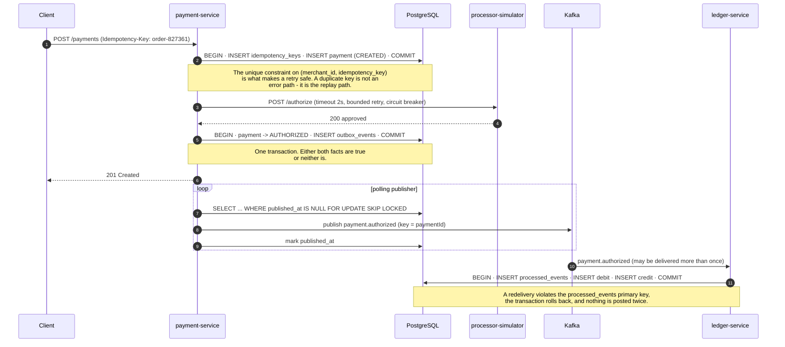

# Distributed Payments Platform

**A payment platform built to survive the things that actually go wrong: duplicate requests, timed-out
dependencies, redelivered messages, and traffic that arrives faster than the database can serve it.**

Java 21 · Spring Boot 3 · PostgreSQL · Kafka · Redis · Kubernetes · Resilience4j · OpenTelemetry · Gatling

[](https://github.com/Necrote/distributed-payments-platform/actions/workflows/ci.yml)

> **Status: Phase 2 in progress.** `payment-service` runs end to end in Docker: create, fetch,
> capture and refund through an enforced state machine, on PostgreSQL, tested in CI against a real
> PostgreSQL. `POST /payments` is idempotent: a retry replays, a reused key with a different body
> is a `422`. The processor integration, Kafka and the ledger are **not built yet**.
> The rest of this README describes the target design; [the roadmap](#roadmap-and-honest-status)
> says exactly which parts are real today.

---

## What problem does this solve?

Taking a payment is easy. Taking it **exactly once** is the hard part, and it stays hard because
every interesting failure happens between two systems rather than inside one:

- the client's HTTP request times out and it retries — did the first attempt charge the card?
- the database commit succeeds and the Kafka publish fails — the payment says `AUTHORIZED` and no
  downstream service will ever hear about it;
- the message broker redelivers an event after a consumer rebalance — the ledger posts twice;
- two support agents click *capture* at the same moment — one payment, two captures;
- the processor gets slow rather than failing, so nothing errors, nothing alerts, and every request
  thread in the service ends up waiting on it.

This project implements a payment lifecycle where each of those has a named, tested answer, and where
you can reproduce the failure yourself in about thirty seconds.

## Run it

You need Docker. Nothing else - the image builds the service with its own JDK and Maven.

```bash
git clone https://github.com/Necrote/distributed-payments-platform.git
cd distributed-payments-platform
docker compose up -d --build --wait     # PostgreSQL + payment-service; returns once both are healthy
```

Create a payment (amounts are minor units - `12500 INR` is ₹125.00):

```bash
curl -i -X POST http://localhost:8080/payments \
  -H 'Content-Type: application/json' \
  -H 'Idempotency-Key: order-827361' \
  -d '{"merchantId":"merchant-123","amount":12500,"currency":"INR","paymentMethodToken":"tok_test_123","externalReference":"order-827361"}'
```

```http
HTTP/1.1 201
Location: http://localhost:8080/payments/e440f939-9c4b-40ea-bdc6-8372845dea64

{"id":"e440f939-...","merchantId":"merchant-123","amount":12500,"currency":"INR","status":"CREATED",...}
```

Send the exact same request again: `200`, the same payment, `Idempotent-Replayed: true`, and no
second row. Now reuse the key with a different amount:

```bash
curl -i -X POST http://localhost:8080/payments \
  -H 'Content-Type: application/json' \
  -H 'Idempotency-Key: order-827361' \
  -d '{"merchantId":"merchant-123","amount":999,"currency":"INR","paymentMethodToken":"tok_test_123","externalReference":"order-827361"}'
```

```http
HTTP/1.1 422
Content-Type: application/problem+json

{"type":"about:blank","title":"Idempotency-Key reused with a different request","status":422,
 "detail":"Idempotency-Key 'order-827361' was already used for payment e440f939-... with a different
  request body. Differing fields: amount. To retry that payment, resend its original body unchanged.
  To create a new payment, use a new Idempotency-Key.",
 "instance":"/payments","idempotencyKey":"order-827361","originalPaymentId":"e440f939-...",
 "differingFields":["amount"]}
```

Then try the other things that should fail, and see how they fail:

```bash
curl http://localhost:8080/payments/<id>                     # 200, the payment
curl -X POST http://localhost:8080/payments/<id>/capture     # 409: CREATED cannot move to CAPTURED
curl -X POST http://localhost:8080/payments -H 'Content-Type: application/json' \
  -d '{"merchantId":"m","amount":1,"currency":"XYZ","paymentMethodToken":"t"}'   # 400, names the field
```

Every error is an RFC 7807 `application/problem+json` body. The full API is at
<http://localhost:8080/swagger-ui.html>. On Windows PowerShell, `curl` is an alias for
`Invoke-WebRequest`. Use `curl.exe` or Git Bash instead.

Run the tests (unit tests plus integration tests against a throwaway PostgreSQL via Testcontainers;
needs Docker and JDK 21): `cd payment-service && mvn verify`. Tear down with `docker compose down -v`.

## Architecture



| Service | Responsibility |
|---|---|
| `payment-service` | The only public API. Owns the payment state machine, idempotency, the transactional outbox, and every call to the processor. |
| `processor-simulator` | A fake external processor whose only job is to fail on demand: slow, 500, 429, intermittent, duplicate response, total outage. |
| `ledger-service` | Consumes payment events and posts append-only double-entry ledger lines. Idempotent, because Kafka delivers at least once. |

## Why this architecture?

- **PostgreSQL is authoritative, everything else is derived.** Redis can be down and payments stay
  correct. Kafka can be down and payments stay correct; the events queue up in an outbox table and
  drain when it comes back.
- **Idempotency is enforced by a database unique constraint, not by a cache lookup.** A cache makes
  the check fast; only the constraint makes it *true* under concurrency.
- **The state change and its event are written in one transaction** (transactional outbox), because
  `save(); kafka.send();` is two operations that can half-succeed.
- **Delivery is at-least-once; the business effect is exactly-once.** The broker is allowed to
  redeliver; the consumer records `event_id` in the same transaction as its writes, so a replay posts
  nothing. This project never claims exactly-once delivery, because nothing has it.
- **Money is a `long` of minor currency units plus a currency code.** `12500 INR` is ₹125.00. There
  is no floating point anywhere near an amount.

## Idempotency

A client whose `POST /payments` times out can't tell whether the payment was created. Its only safe
move is to retry, sometimes while the first attempt is still running. So the client sends an
`Idempotency-Key` header (scoped per merchant), and the service guarantees **three properties**:

1. **A retry never creates a second payment**, even when it arrives while the first is in flight.
2. **A retry gets the original answer**: the first response, byte for byte, not the payment's
   current state.
3. **A reused key with a different request is rejected** with a `422`, never answered with the
   first payment.

**How it works, in four steps:**

1. Fingerprint the request: SHA-256 of the parsed body, keys sorted, no whitespace.
2. In **one** database transaction: insert a row into `idempotency_keys` under
   `UNIQUE (merchant_id, idempotency_key)`, insert the payment, and store the response on the key
   row.
3. If the insert hits that unique constraint, the key was already used. That transaction is now
   dead, so recovery happens *after* it rolls back: read the stored row in a fresh transaction.
4. Same fingerprint → replay the stored response with `200`. Different fingerprint → `422`.

The full reasoning, the alternatives rejected, and what this makes hard are in
[ADR-004](docs/adr/0004-idempotency-keys.md).

| Same key, and… | Response | Writes |
|---|---|---|
| first time seen | `201 Created`, `Location` | one payment, one key row, one transaction |
| same request again | `200 OK`, the **original** body, byte-identical, `Idempotent-Replayed: true` | nothing |
| same request, first still in flight | waits on the unique index, then `200` (first committed) or `201` (first rolled back) | at most one payment either way |
| **different** request | `422`, naming the original payment and the differing fields | nothing |

**How "same request" is decided.** The request is fingerprinted as the SHA-256 of its *parsed* body,
serialised with keys sorted at every level and no whitespace. A client that sends the same fields in
a different order, or with different spacing, has sent the same request and gets the replay.
Changing any value, including the card token, is a different request.

**Why a different body is a `422` and never a replay.** Suppose the key first charged ₹125.00 and is
reused for ₹9,999.00. A replay would answer `200`, and the client would record ₹9,999 as charged
while we charged ₹125. A silent success is the expensive failure. It surfaces weeks later in
reconciliation, far from its cause. The `422` fails at the bug, and its message is written so the
client developer can fix their own code without contacting us: which payment the key belongs to,
which fields changed (names only, never values), and the two ways out.

**Why the database decides, and not a check in code or a cache.** "Look for the key, insert it if
absent" has a gap that two simultaneous requests can both fit through. The unique constraint has no
gap: a concurrent retry *waits* on the index until the first transaction ends. Then it either finds
the key (the first committed, so it replays) or doesn't (the first rolled back, so it creates). Redis
isn't the safeguard either. It isn't in the payment's transaction, a failover can lose a key it had
acknowledged, and `allkeys-lru` eviction can delete one under memory pressure. Each of those makes
a retry look new, which is a second charge. Redis may later make the lookup *faster*; the constraint
stays what makes it *true*.

**Why the recovery runs outside the transaction.** Once the duplicate-key error fires, PostgreSQL
refuses every further statement in that transaction. Catching the error inside it and reading the
stored row there fails, and it fails three different ways, all reproduced. So the catch lives a
layer up, and the read gets a transaction of its own.

### The evidence

Each property is tested against a real PostgreSQL (Testcontainers), with real threads:

| Property | Test | What it shows |
|---|---|---|
| 1. No second payment, under concurrency | `PaymentControllerIT` (20 threads) | 20 identical requests released together by a latch: **one `201`, nineteen `200`s, 20 identical ids, one row**. 20 is twice the connection pool, on purpose. |
| 1. …including mid-flight | `PaymentApplicationServiceIT` | The first transaction is held open, and `pg_stat_activity` confirms the retry is *waiting on the lock*. Commit → the retry replays. Roll back → the retry creates. One row either way. |
| 1. Key and payment are atomic | `PaymentApplicationServiceIT` | The key row is flushed, then the payment insert fails: afterwards, **no key row and no payment**. |
| 2. The original answer | `PaymentControllerIT` | The second response *string-equals* the first. After the payment is authorised, a replay still says `CREATED`. |
| 3. Different body → 422 | `PaymentControllerIT` | 12500 then 999 with one key → `422`, still exactly one payment, at 12500. Neither amount appears in the error. |
| "Same request" is semantic | `PaymentControllerIT`, `CanonicalRequestHashTest` | A reordered, re-spaced body replays (`200`, not `422`). The hash is pinned to a SHA-256 vector computed independently. |

## Payment flow



## Failure handling

| Failure | What happens                                                                     | Where it is demonstrated |
|---|----------------------------------------------------------------------------------|---|
| Client retries the same request | Same payment returned, no second charge                                          | `PaymentControllerIT`, `PaymentApplicationServiceIT` |
| Same key, different payload | `422`, never a silent replay of a different amount                               | `PaymentControllerIT.sameIdempotencyKeyWithDifferentPayloadIsRejected` |
| Two concurrent captures | One wins on the optimistic-lock version, the other gets `409`, never retried     | `PaymentControllerIT`, `PaymentApplicationServiceIT` (20 runs each) |
| Processor slow | Client-side timeout bounds the wait; bulkhead stops it consuming every thread    | *Phase 3* |
| Processor returning 500 | Bounded retry with jitter, then the circuit breaker opens and requests fail fast | *Phase 3* |
| Processor times out | Attempt recorded as `UNKNOWN`; reconciliation, never a blind retry               | *Phase 3* |
| Kafka down | Payments still succeed; the outbox drains when the broker returns                | *Phase 4* |
| Duplicate Kafka delivery | `processed_events` makes the second delivery a no-op                             | *Phase 4* |
| Redis down | Correct, just slower, the cache is never the source of truth                     | *Phase 5* |
| Connection pool exhausted | Reproduced deliberately, measured, then fixed                                    | *Phase 8* |

## Consistency model

Within `payment-service`, a payment and its idempotency key and its outbox event are **strongly
consistent** - one PostgreSQL transaction. Across services the model is **eventual consistency**: for
a short window a payment can be `CAPTURED` while the ledger has not posted yet. That is a design
choice, not a defect, and the API is honest about it; the ledger endpoint can legitimately return
"not posted yet". The alternative, a distributed transaction across both services, trades a
significant amount of availability for a guarantee this domain does not need.

## Testing

`cd payment-service && mvn verify` runs both suites. Mutation testing is a separate goal:
`mvn test-compile org.pitest:pitest-maven:mutationCoverage`.

| Suite | What it covers | Runs on |
|---|---|---|
| Unit (`*Test`) | Domain rules, the canonical hash, the HTTP contract with the service mocked | `mvn test`, no Docker |
| Integration (`*IT`) | Real PostgreSQL via Testcontainers: transactions, constraints, concurrency | `mvn verify`, needs Docker |
| Mutation (PIT) | Whether the unit tests would *notice* a change to `domain` and `service` | CI job, gated |

**Concurrency is tested with real threads against a real database,** never with `Thread.sleep`:
20 identical `POST /payments` with one key, released by a latch, give exactly one row and 20
responses carrying the same id. Two simultaneous captures give exactly one capture, run 20 times,
plus a deterministic twin that forces the stale read.

**Mutation score, measured, not chosen** (PIT 1.16, `domain` + `service`, unit tests only):

| Date | Killed | Score | Test strength | Line coverage |
|---|---|---|---|---|
| 2026-10-19, first run | 77 / 121 | 64% | 87% | 75% |
| 2026-10-19, after killing the weakest survivors | 91 / 121 | **75%** | 99% | 76% |

- **Line coverage moved one point, and mutation score moved eleven.** The `Payment` entity's lines
  were already *executed* by other tests, but nothing asserted on them. Deleting the state-machine
  guard from `Payment.transitionTo` survived. So did removing the positive-amount check, and a
  `<` → `<=` boundary in `Money` formatting that would print zero as `-0.00`. Each now has a test.
- **The CI gate is 75**, just under the measured 75.2%. Disabling one test drops the score to 74
  and fails the build. That was checked before trusting the gate. The gate goes up as the score
  does.
- **What's left:** one *equivalent* mutant (`target == null` in `PaymentStatus.canTransitionTo`,
  which `EnumSet.contains(null)` already makes false). The other 29 unkilled mutants are in code
  only the integration tests reach (`PaymentApplicationService`, `IdempotencyKey`). PIT doesn't run
  Testcontainers, so that code is well tested but not mutation-tested.

## Roadmap and honest status

**Works today**

- `POST /payments`, `GET /payments/{id}`, `POST /payments/{id}/capture`, `POST /payments/{id}/refund`.
- A state machine that rejects illegal transitions with `409` and names the current status, all 49
  state pairs tested. See [ADR-006](docs/adr/0006-payment-state-machine.md).
- Money as `long` minor units + ISO-4217 currency, validated at the API (`400`, never a `500`).
- PostgreSQL schema owned by Flyway; Hibernate only validates it.
- Idempotent `POST /payments`: replay with the original response, `422` for a reused key with a
  different body, proven under concurrency against a real PostgreSQL. See [Idempotency](#idempotency).
- Optimistic locking on the payment row: two simultaneous captures give exactly one capture, and
  the loser gets a `409` that tells it to fetch the payment before retrying.
- Uniform RFC 7807 errors; OpenAPI/Swagger UI generated from the controllers.
- CI on every push: unit tests and Testcontainers integration tests against a real PostgreSQL,
  plus a PIT mutation-score gate set from a measured score. See [Testing](#testing).
- Multi-stage Docker image (JRE-only Alpine runtime, non-root user) and `docker compose up`.

**Not built yet - and the gaps this leaves today**

- **The `Idempotency-Key` is still optional.** A `POST` without one creates a payment with no
  replay protection, so a client that retries it gets a second payment. Making the header required
  is next. Expired keys are not swept yet either, so they keep replaying past 24h.
- **No processor.** Nothing moves a payment from `CREATED` to `AUTHORIZED` in the running stack,
  so capture and refund can only be reached in tests, through a temporary admin endpoint that is
  disabled by default and is deleted in Phase 3. `processor-simulator` is scaffolded; its
  endpoints return `501`.
- **No Kafka, outbox or ledger.** `GET /payments/{id}/ledger` returns `501`. `ledger-service` is a
  placeholder with no runnable logic.
- **Concurrency is proven for capture only.** Two simultaneous captures give exactly one `200`
  and one `409`, and the test fails if `@Version` is removed. Refund takes the same path but has
  no race test of its own yet.
- No auth, no Redis, no metrics dashboards, no Kubernetes, no load-test numbers. Nothing on this
  page is a performance claim.

**Deliberately out of scope - known limitations, not oversights**

- **Full refunds only.** No partial refunds: a second refund of the same payment would be a double
  reversal, and the schema enforces one active refund per payment.
- **No disputes or chargebacks, and no authorisation expiry.** Each is a lifecycle of its own. The
  seven-state machine is enough to show the pattern, and why it stops there is in
  [ADR-006](docs/adr/0006-payment-state-machine.md).
- **Single currency per payment, with fixed minor-unit exponents** (INR/USD 2, JPY 0). No FX.

| Phase | Scope | Status |
|---|---|---|
| 1 | Payment lifecycle, state machine, PostgreSQL, OpenAPI, Docker | Done |
| 2 | Idempotency, unique constraints, optimistic locking, concurrency tests | **In progress**: idempotent create and concurrent capture done; required key and expiry sweep next |
| 3 | Processor simulator, timeouts, retry, circuit breaker, bulkhead (`v0.1`) | Scaffolded (endpoints return `501`) |
| 4 | Kafka, transactional outbox, ledger service, idempotent consumers (`v0.2`) | Scaffolded (no runnable logic) |
| 5 | Redis cache and idempotency acceleration, measured | Not started |
| 6 | OpenTelemetry, Prometheus, Grafana, structured logging | Not started |
| 7 | Kubernetes, Helm, probes, HPA scaling experiments | Not started |
| 8 | Gatling, HikariCP experiment, incident postmortems (`v1.0`) | Not started |


